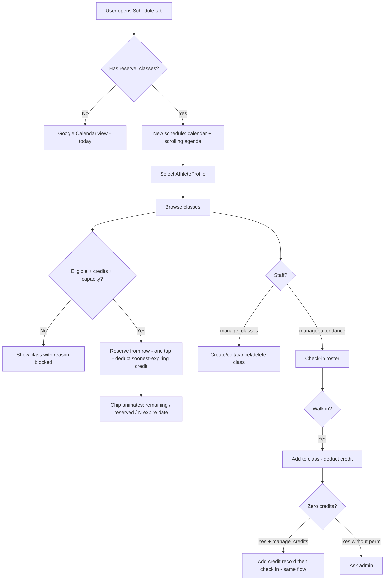

# Class Reservation System — Product Requirements Document

**Version:** 1.3 (credit inventory design)  
**Status:** Pre-engineering  
**Scope:** Product and UX requirements only (no implementation specifics)  
**Last updated:** 2026-11-22  
**Client walkthrough:** [CLASS_RESERVATION_WIREFRAMES.md](./CLASS_RESERVATION_WIREFRAMES.md) — MVP screen wireframes and flows (members, coaches, admin)  
**Credit inventory:** [CREDIT_INVENTORY.md](./CREDIT_INVENTORY.md) — schema and spending rules (Task 2.1)  
**Beta checklist:** [CLASS_RESERVATION_BETA_CHECKLIST.md](./CLASS_RESERVATION_BETA_CHECKLIST.md) — manual dark-launch pass (Task 13.1)  
**Later phases:** [CLASS_RESERVATION_LATER_PHASES.md](./CLASS_RESERVATION_LATER_PHASES.md) — everything after the dark launch, not yet split into Phase 2 and Phase 3

This document is the **source of truth for the dark launch**. Later-phase requirements live in the later-phases file. The wireframes describe how MVP screens look and walk; if they disagree with this file, update this file first, then the wireframes. If a later-phase rule changes, update the later-phases file.

---

## 1. Background and Goals

### Current state

- DC Vault has an older **website** (registration, PayPal payments, quarterly packages, discount codes) and a newer **mobile app** (Expo/React Native).
- Class scheduling today uses **Zen Planner**, which admins update manually when athletes purchase on the website. Members reserve classes in Zen Planner; the app **Schedule tab reads from Google Calendar** for the public practice schedule.
- **Users** have **Athletes** (registration/billing entity) and **AthleteProfiles** (mobile app entity, 1:1 with Athletes). A user may manage **multiple athletes** and switches between them via AthleteProfiles in the app.
- Website registration info explicitly references Zen Planner for reservations and the website calendar for schedule/cancellation updates.


### Product goal

Build a first-party **class reservation system** in the mobile app that eventually replaces Zen Planner, while maintaining continuity with website registration and the existing member experience during a long phased rollout.

### Key objectives

1. Members view schedule, reserve/cancel classes, and see participation — in-app.
2. Staff create/manage classes, check in athletes, and adjust credits when needed.
3. Website purchases flow into the new system and appear correctly in the app.
4. Zen Planner and the existing Google Calendar schedule remain operational until full release.
5. Improve visibility into attendance, remaining classes, and athlete progress.


### Success criteria (launch)

- Beta users with permission can reserve and cancel within policy constraints.
- Website registrations appear in app credit inventory without manual Zen Planner entry (target state before dark launch).
- Staff can manage classes and check-in without external tools (for beta cohort).
- No partial/broken UI for users without permission — they see today's Schedule experience unchanged.


### Phasing philosophy

This is a **multi-phase, multi-session project**. Requirements below distinguish **MVP (dark launch)** from **later phases**. Some engineering design tasks (credit inventory, private lesson payments) are explicitly deferred to dedicated design sessions.

---


## 2. Rollout and Coexistence


### Dark launch (beta)

- New system enabled per-user via `reserve_classes` **permission** (see §13).
- Beta testers use the new Schedule/reservation experience.
- Everyone else sees the **existing Google Calendar Schedule tab** unchanged.
- **Zen Planner continues** for non-beta users and as a fallback until full release.
- Admins continue manually updating Zen Planner for website purchases **until** the new system reliably receives website purchase data.


### Pre-dark-launch requirement

All class **configuration scenarios** (§5) must be supported before dark launch — not necessarily as named "class types," but as configurable class properties that cover every use case.

### Full release (future)

- Zen Planner retired for reservations.
- All members migrated to in-app reservations.
- Communication plan TBD.


### Platform scope


| Capability                        | MVP (dark launch) | Later                                     |
| --------------------------------- | ----------------- | ----------------------------------------- |
| View/reserve classes in app       | Beta users only   | All members                               |
| Website registration → new system | **Required**      | Required                                  |
| In-app registration/payment       | Out of scope      | Full parity with website                  |
| Waivers / registration fields     | Website handles   | App parity when in-app registration ships |


---


## 3. Feature Access


### Decision: permissions only (no feature toggle system)

Use the existing permissions system. No `manage_feature_toggles` or backend toggle infrastructure.

### Member-facing gate

- Permission: `reserve_classes`
- When **granted**: Schedule tab shows the new class reservation experience.
- When **not granted**: Schedule tab shows the **current Google Calendar view** (today's behavior).


### Session behavior

Permission state loads with the user session and refreshes on token refresh (consistent with existing app auth patterns).

---


## 4. Schedule Tab (Member-Facing)


### Purpose

Primary interface for viewing the class schedule and reserving/canceling sessions.

### Views

- **Monthly calendar** at the top (existing pattern) plus a **single scrolling agenda** below.
- **No Upcoming / Past toggle.** Past classes stay in the same list, visually dimmed. By default, load about the **past 2 weeks** plus upcoming classes; older history is reached from profile history (§10), not by paging the Schedule tab infinitely.
- Color-coded class rows (see §5 / §6). Calendar day markers are **not** the class-type color: they distinguish **reserved vs not reserved** for the selected athlete (see below).


### Calendar day indicators

Class-type color lives on the **list rows** and on the month markers. The shape is the reserved signal, so color is not the only way to tell a reserved day from a class day:

- Each class color that day gets one marker, using that class’s color. A class with no color uses the app tint.
- No reservation for that color: an open ring.
- A reservation in that color: a filled dot.
- Days with no classes: no marker.

Two classes of the same color share one marker. If either is reserved, the marker is filled.

### Display per class

- Title, start/end time, location, description
- Spots remaining / capacity status
- **Eligibility indicator** — if the selected athlete cannot reserve, show **why** (visible but blocked; not hidden)
- Attendance indicator for past classes (for selected athlete — see §10)
- Class note/suggestion field (e.g., pole needed — see §8)


### Credit chip (always visible)

The Schedule header always shows credit status for the selected athlete (not only when remaining is low). It must update immediately after reserve/cancel.

Show:

- **Remaining** — unused credits still available to book.
- **Reserved** — count of upcoming reservations for this athlete (credits already pulled for those spots).
- **Expiring soonest** — how many remaining credits expire on the soonest date, e.g. `4 expire Sep 30` (not only `expires Sep 30`).

Example: `8 remaining · 3 reserved · 4 expire Sep 30`.

If the athlete has a spendable **unlimited** grant, the chip shows `Unlimited` instead of a remaining count (`Unlimited · 3 reserved · through Nov 30`). Finite grants are still spent first. Details: [CREDIT_INVENTORY.md](./CREDIT_INVENTORY.md) §8.

On reserve (and cancel, when a credit returns), **animate** the remaining and reserved numbers so the spend is obvious without a confirm sheet (count change, brief emphasis on the chip). An unlimited chip animates the reserved count only. Exact motion is a visual-design choice.

### Actions

- **Reserve from the schedule row — one tap, no confirm sheet** when the class costs credits. The member does **not** have to open class detail first. Tapping Reserve commits immediately: deduct credit, mark the class Reserved, update the chip with the credit animation. Accidental reserves are undone by canceling within the cutoff (Flow B still uses a confirm, because that returns a credit).
- **Dollar-cost classes** (private lessons and other pay-at-reserve classes) use a confirm sheet that shows the price. MVP does not charge a card; staff invoice outside the app. See §7.
- **Cancel reservation** — within policy window (from the row, detail, or upcoming list). Cancel still asks for confirmation.
- **View class details** — including roster (see below). Opening detail is optional for a normal weekly reserve. Reserve on detail is also one tap (same as the row).
- **Register / buy classes** entry point when athlete has no usable credits (links to registration flow when available; for MVP, may direct to website)


### Capacity

- **Hard stop when full** — no waitlist in MVP.


### Roster visibility

- Attendee **count** shows on the class for anyone who can open it. **Names**, **photos**, and training-group labels are on the attendees screen. Class detail has a small tertiary **View attendees** button beside the spots count for someone who can see that list. The schedule row’s **Check in** button, when check-in is open, opens the same screen. When Reserve or Cancel cannot be used, that button stays on class detail, disabled, with the reason underneath.
- `view_class_roster` can read that list for a class members can see. `manage_attendance` can read it too, including a hidden class, because that is the check-in list. A hidden class stays hidden from `view_class_roster` unless the caller also has `manage_classes` or `manage_attendance`.
- The list is reserved people, then walk-ins. A missing photo shows initials. Nobody signed up says **No one is on this class yet.**
- MVP: grant `view_class_roster` to regular members and coaches. Confirmed OK for gym culture for now; can tighten to coaches-only later if needed.
- Tapping a name opens the athlete profile (per existing privacy rules). The Athletes roster is anchored underneath when it is not already there.
- Without `view_class_roster` or `manage_attendance`, only the count shows (“6 of 18”).


### Staff actions (same screen)

Users with `manage_classes` can create/edit classes from the Schedule tab (see §5).

### Empty states

Copy needed for: no upcoming classes, athlete ineligible for all visible classes, athlete has no credits, feature not available (falls back to old calendar — user shouldn't normally see this state).

---


## 5. Class Configurations (Not Formal "Types")


### Approach

Do **not** build a rigid "class types" catalog for MVP. Instead, provide **configuration options** that express all current use cases. **Presets** for common setups (open class, private lesson, break, etc.) may be added later for staff efficiency.

### Configurable properties


| Property                          | Notes                                                                                                         |
| --------------------------------- | ------------------------------------------------------------------------------------------------------------- |
| Title                             |                                                                                                               |
| Description                       |                                                                                                               |
| Start / end time                  | Per occurrence; custom series may use **different times on different days**                                   |
| Location                          | One place for the series in the first build, including the address. A single date can still use a different place. Each weekday having its own location is later (L1 in the later-phases doc). |
| Allowed athlete groups            | Fly Kids, Open/All Ages, Adult, Elite Development, etc.                                                       |
| Age limits                        | Optional                                                                                                      |
| Recurrence                        | Simple weekly **or custom multi-day** (see below). Edits apply to **single instance** or **entire series**    |
| Reservation cutoff                | Duration **before class start** (e.g. 24 hours before), not a clock time that day                             |
| Cancellation cutoff               | Duration **before class start** (e.g. 24 hours before), not a clock time that day                             |
| Max capacity                      | Single number per class/session                                                                               |
| Cost                              | **Credits and/or money**: credit cost (0, 1, …) and/or dollar cost for paid events / lessons                  |
| Visibility                        | Hidden vs visible on member schedule                                                                          |
| Color                             | Manual or default from athlete group                                                                          |
| `isReservable`                    | `false` for display-only items (meets, breaks)                                                                |
| Requires approval                 | **Not used in MVP.** Private lessons reserve immediately like other classes. An approval flow is later (L11). |
| Sends notification on reservation | Available as a class setting; MVP private lessons do not require a special request/approve loop               |
| Coaching staff                    | Multiple; coaches have athlete profiles                                                                       |
| Class note / pole suggestion      | Free-text note shown to members (e.g., "Bring your 14' pole")                                                 |
| Max attendees (lessons)           | Configurable — supports private → semi-private adjustment                                                     |
| Lifecycle                         | **Active**, **canceled** (still on calendar, reversible), or **deleted** (removed, confirmed, not reversible) |


### Behaviors by use case


| Use case                        | MVP behavior                                                                                        |
| ------------------------------- | --------------------------------------------------------------------------------------------------- |
| Open / all-ages classes         | Reservable; group restrictions via config                                                           |
| Age-restricted / group-specific | Reservable; eligibility enforced                                                                    |
| Private lessons                 | Reservable **immediately** (same as group classes). No request/approve in MVP. Price confirm, no card charge, no group credits (§7) |
| Semi-private lessons            | Same as private; staff increases capacity as needed                                                 |
| Meets                           | **Visible only, not reservable**                                                                    |
| DC Vault hosted events          | Configurable credit and/or dollar cost; reservable if `isReservable`                                |
| Non-bookable items (breaks)     | Visible, not reservable                                                                             |
| Community events                | Free (`credit cost = 0`), sign-up if reservable                                                     |


### Recurrence

- Typical case: weekly on one weekday at one time.
- **Custom series required for MVP:** one series can include mixed days and times, e.g. Sunday 11:30, Tuesday 6:00 PM, Thursday 7:00 PM. Staff add those day/time rows rather than creating three unrelated series when it is conceptually one repeating class.
- Those rows do not have their own location. Every weekday uses the series location and address. Giving a weekday its own standing place is later (L1). Editing one date can still put that date somewhere else.
- A repeating series may set an optional **end date**. That date is included. With no end date, the series continues.
- A short run such as a week-long camp is a repeating series with an end date and one slot per weekday it meets. It does not continue after the end date. A non-repeating class is a single session.
- Edit **this occurrence only** or **entire series**.
- Moving one session of a repeating series keeps it on that series. That original date drops off the schedule, the session shows on the new date, and the other weeks stay. The new day cannot be a weekday the series already uses. Moving a non-repeating class changes the series date itself.
- Two sessions of one series do not fall on the same calendar day. A second session that day is a separate series.
- Series edits stay compatible with a later bulk update of notes or poles (L9). That bulk action is not in the dark launch.


### Cancel vs delete (staff)

These are different actions:

- **Cancel a class (or series):** reversible. The class **stays on the calendar** marked canceled so the week still looks complete. Members with reservations are eligible to be notified (staff can also save/cancel **without** notifying — see §12).
- **Delete a class (or series):** permanent. It **disappears** from the calendar. Requires an explicit confirmation. Deleting a series asks **this occurrence only** vs **entire series**.

Canceling a **member’s reservation** is a separate action (see §8 / §9) and does not delete the class.

### Cost: credits and/or money

Staff choose how the class is paid for:

- Credit cost, a whole number, including 0 for free sign-up items. Package grants are whole numbers too.
- Dollar cost (paid events / lessons).
- Both, if a class should consume a credit **and** collect money (rare; keep the fields independent so staff are not forced into one model).

Dollar-cost classes confirm the price and reserve without calling PayPal in MVP. Staff invoice outside the app (§7). The configuration must exist so events and lessons can be described correctly.

### Duplication

- Staff can **copy settings from an existing class** to speed setup.


### Staff UX

- Create/edit via **bottom sheet** or modal.
- Large touch targets; mobile-first admin UX.

---


## 6. Google Calendar Integration


### Source of truth

The **app/backend class system is the source of truth** for beta users.

### During transition

- The **existing public Google Calendar** (website practice schedule) is **maintained separately** by staff. Non-beta members keep that workflow.
- The new system does not write that public calendar.
- A one-way push to a **separate** Google Calendar is later and was not built. The rules are L37 in [CLASS_RESERVATION_LATER_PHASES.md](./CLASS_RESERVATION_LATER_PHASES.md).


### Later

Personal calendar subscription (L38), and moving the public website calendar onto this system when Zen Planner is retired (L39), are in that same file.

---


## 7. Registration, Packages, and Credits


### Core model: flexible expiration with quarter overlay

Build the credit system on a **flexible expiration model**:

- Each package has: **credit count**, **expiration date**, optional **start date**, optional **no expiration** (unlimited).
- **Quarter-bound behavior** is a policy layer: set expiration to end-of-quarter. This layer can be removed later without rewriting the core model. MVP uses fixed seasons (Dec–Feb, Mar–May, Jun–Aug, Sep–Nov). An admin-configured season calendar is later (L21).

MVP packages are **a total number of classes for a period** (configurable count, including effectively unlimited). **N classes per week** during the period is later (L20). The inventory model does not assume a total count is the only product that will exist.

When weekly-allotment packages ship: unused classes **do not roll**. If the package is 3 per week and the athlete only uses 1, the leftover 2 **vanish at the end of that week**. The point is to incentivize showing up more often.

### Entity relationships

- Credits belong to **Athletes** (not AthleteProfiles).
- App UX operates through **AthleteProfile selection** (user switches profile → underlying Athlete).
- Multiple athletes per user: all reservation/registration flows respect the **currently selected AthleteProfile's Athlete**.


### Website registration (MVP requirement)

- A database flag selects the registration catalog. **Off (default):** today’s hardcoded form, including invite-only groups. Those purchases do **not** create credits. **On:** the form lists active rows from the class-package catalog (public packages, plus hidden packages after a matching invite code). Checkout still writes `purchases`, then creates one credit grant. Idempotent on the PayPal payment.
- **No backfill.** Athletes who already paid are adjusted by hand.
- App displays remaining classes, expiration, and purchase history for athletes who have grants.
- Zen Planner manual credit entry continues in parallel until full cutover.
- Schema, seed, invite levels, and spending rules: [CREDIT_INVENTORY.md](./CREDIT_INVENTORY.md).


### In-app registration (later)

- Entry points (when built): Schedule tab, athlete profile, out-of-credits prompts.
- Must eventually achieve **full parity** with website registration (packages, waivers, fields, discounts, PayPal).
- **Not in the dark launch.** The requirement is L17 in the later-phases doc.


### Multiple packages

- Athletes may hold **multiple active packages** (e.g., bought more when running low).
- **Deduction rule (MVP):** consume credit from the package **expiring soonest** among eligible packages (respecting start dates).
- **Display:** show **sum of remaining credits** across active packages, **how many of that remaining pool expire on the soonest date** (e.g. `4 expire Sep 30`), plus upcoming **reserved** count on Schedule (§4).


### Package start date

- Packages may have an optional **start date** — credits unusable until then.
- Supports **early purchase for next quarter** — those credits only apply to classes on/after the start date.


### Unlimited packages (MVP)

- Unlimited means **no credit count** (`creditCount` / grant `quantity` is null), not a stand-in number such as 30 or 50 and not a separate flag. The grant still has an expiration when the product has one (the seeded All Ages unlimited package expires at the end of the purchased quarter). A staff grant may omit expiration until someone ends it.
- **Taking unlimited away** sets that grant’s expiration to now. The original expiration is left as it was created, so an early end is “expiration changed.” The row stays so history and existing reservations still have something to point at. The same “end this package” action can end a finite grant early. Deleting the row and inserting a negative cancel row are not the mechanism.
- Finite add and remove still create **new** grants (§ staff adjustments below). A negative grant cannot end an unlimited package.


### Staff credit adjustments preserve history

Adding or removing credits is **not** a silent edit of the existing package’s quantity.

- Each add or remove creates a **new credit grant** so purchase/adjustment history stays intact (e.g. “+1 makeup credit” appears as its own line rather than rewriting “16 → 17” on the original quarterly package). A removal is a new grant with a negative count. It does not edit the original grant.
- How many credits are left is **computed**: grant quantity minus reservations that are still holding a credit. It is not a stored column. Check-in and no-shows do not change the balance; the credit was already taken when they reserved.
- **End package** is the exception: it sets that grant’s expiration to now and does not insert another row. An early end is visible because that date no longer matches the expiration stored at creation. Use it to take an unlimited package away, or to stop an entire finite grant early. It does not apply to a credit removal. Ending a removal would drop the negative count and give the credits back.
- Staff pick the window for a new add or remove. The default is the current quarter. They can pick another season, a custom start and last day, or no expiration. No expiration is usable immediately and stays until someone ends that grant. An unlimited package is a separate choice on the add form. Leaving the amount blank does not create one.
- Members still see a **summed** remaining count, or `Unlimited` when a spendable unlimited grant exists. History shows each grant, removal, and early end separately.


### Private lessons and dollar purchases

- A private lesson is a class configuration, not a separate product: dollar price, small capacity, notify on reserve. It does **not** spend group credits. Website registration does not sell lesson packs in MVP.
- **Payment (MVP):** reserving shows a confirm sheet with the price and saves the reservation. No PayPal call. Staff are notified and invoice outside the app. They can cancel the reservation with `manage_classes`.
- Real card charging at reserve is later (L18). A lesson-credit pool can be added later with a `creditPool` column (L19). Do not add that column in the dark-launch schema. See [CREDIT_INVENTORY.md](./CREDIT_INVENTORY.md) §9.


### Discount codes

- MVP: **no changes** — existing website discount system and rules apply to website purchases.
- No in-app discount management (`manage_discounts` not needed for MVP).
- Coaches continue to **hand out codes manually** for MVP.
- When in-app registration ships later, discount validation must match website behavior.
- **Later (L23):** configurable **automatic** discounts (early bird, military, and similar) that apply without a coach issuing a code. Those discounts cover **packages and paid events**. The early-bird window is a **configurable amount of time** (staff set how long the discount runs), not a hardcoded date rule.


### Refunds (MVP)

- **Out of scope.** Coach handles money manually; admin adjusts credits via `manage_credits`.


### Active member status

An athlete is an **active member** if they have purchased a package for the current period (even if all credits are used).

- Unlocks existing app behaviors tied to registration (e.g., log access).
- Edge case: refunded purchase ending active status — handle manually for MVP.

---


## 8. Reservations


### Prerequisites to reserve

1. Selected athlete has **unused, non-expired credits** of the applicable type (group credits for group classes). A dollar-priced lesson does not spend group credits; the member confirms the price and is not charged (§7).
2. Current time is **before reservation cutoff** (cutoff = configured duration before class start).
3. Athlete meets **eligibility** (training group, age, etc.).
4. Class is `isReservable = true`, **not full**, and **not canceled**.
5. Package **start date** has passed (if set).


### Credit consumption

- Reserving deducts the class credit cost (a whole number, often 1) from the **soonest-expiring eligible package** immediately on tap (no confirm step).
- A **canceled** class does not count as a credit spent. The reservation stays and still holds the spot, and the credit hold is paused so the member can use that credit. Restoring the class charges the same amount again from current packages. If any reserved athlete cannot cover it, the restore does nothing. A moved class keeps the reservation and the credit; the reservation date follows the class.
- Display: remaining count, reserved count, and `N expire [date]` for the soonest relevant expiration (§4), with a brief animation on the chip when the numbers change.


### Cancellation (member)

- **Within cancellation cutoff** (duration before start): credit returned to the package it came from.
- **After cutoff:** the member cannot cancel, and the credit stays spent.
- Staff with `manage_classes` can cancel that signup anyway, including after the class has started. The signup and its hold are deleted, so the credit comes back. Adding a credit by hand stays for a balance change that leaves the signup in place.


### Pole / equipment (MVP)

- No structured pole-selection system for MVP.
- Class may include a **note/suggestion field** (e.g., "Bring 14' pole for step 5").
- Member reservation may include a **free-text note** field (storage TBD in engineering design). In the MVP the note is sent with the reserve request and cannot be changed afterward.
- **Later:** the member can add or change that note on a reservation they already hold (L5). Also later: structured pole selection (L6), multi-pole preference order (L7), pinned-pole quick-select (L8), and bulk series updates (L9).


### Reservation management

- View upcoming reservations (per athlete).
- A reservation is for **one session** (one series and one date), not for the whole series. Most sessions have no separate edited-date row.
- Update/cancel before cutoff.
- **Bulk/multi-class reservation:** later (L10).


### Admin on behalf of member

- Staff with `manage_classes` can **cancel a member's reservation** from the attendees row. That deletes the signup and returns the credit, including after the cancellation cutoff. The member can reserve that date again. No message is sent.


### No-show handling

- No explicit "mark no-show" action.
- Athlete with a reservation who is **not checked in** = no-show; credit already consumed at reservation.
- Staff cancel removes that signup and returns the credit. Leaving them on the class keeps the credit spent.


### Notifications

- Member notified when staff add, remove, or end credits (see §12). A notice when staff cancel that member’s reservation is later (L31).
- Class canceled / time / location changes notify through the **class messaging** path, unless staff choose to save without notifying.

---


## 9. Admin Credit and Reservation Management


### Permission: `manage_credits` (separate from `manage_classes`)


| Action                                   | MVP                     |
| ---------------------------------------- | ----------------------- |
| Add credits to athlete                   | Yes (new credit record) |
| Remove credits from athlete              | Yes (new credit record) |
| Cancel reservation on behalf of user     | Yes (`manage_classes`). Deletes the signup and returns the credit, including after the cutoff. |
| Restore credit after late cancel         | The staff cancel returns it. Add credits still changes a balance while the signup stays. |
| Override reservation cutoff or eligibility | **No** — later (L12) |
| Optional note/reason on actions          | **No** — later (L41)    |
| Audit log                                | **No** — later (L40)    |
| Notify user on a credit change           | **Yes**                 |
| Notify user when staff cancel their reservation | Later (L31)         |


### Entry points

- Athlete profile (admin view)
- Class roster / class detail (staff view)

---


## 10. Athletes, Profiles, and Progress


### Training group

- An athlete profile can belong to **more than one training group**, using the same group list as class eligibility (`fly-kids`, `adult`, `allages`, `elite`). This is a join, not a single column. Task 11.1 adds the profile side. No groups means no group limit on a class.
- Those four names are the seed, not a fixed set. Staff with `manage_classes` add groups and rename labels at More → Administrator → Classes → Training groups (task 8.3). A new group’s key is made from its label when it is created and never changes. Groups are not deleted. `edit_training_group` only assigns groups on an athlete’s Edit Profile.
- **Not editable by the athlete/user themselves.**
- Shown and edited on the existing **Edit Profile** screen (not a standalone “Edit Training Group” flow). The field is only writable for users with a dedicated permission (e.g. `edit_training_group` — may or may not be assigned to coach role).
- If unset, eligibility counts the athlete as **Open / All Ages** (catalog key `allages`). That group is not saved on the profile, and the profile still shows no groups. A purchase is not read. If the catalog has no `allages` row, an athlete with no groups is not eligible for a class that lists groups.


### Profile displays (current period)

- Shown on the athlete’s **own** profiles when they have `reserve_classes`, and on any profile for staff with `manage_credits`. Not for every profile viewer.
- **Classes attended** (current quarter)
- **Classes remaining** — sum across active packages
- **Reserved** vs remaining, consistent with the Schedule chip
- **Progress visualization** — semicircle meter (remaining vs total purchased for the displayed period). If a spendable unlimited grant covers the period, show **Unlimited** instead of a fraction. If no grant covers now, hide the meter and show **No classes this quarter** (attended still shows).
- **Expiration timing** — `N expire [date]` for the soonest-expiring remaining credits, or `through [date]` when the visible balance is unlimited


### Progress meter display rules (later)

MVP shows the **current quarter’s** inventory only. The later fallback, including showing next quarter when this quarter is used up, is L26 in [CLASS_RESERVATION_LATER_PHASES.md](./CLASS_RESERVATION_LATER_PHASES.md).


### History (in-app list)

Opened by tapping the progress block on the profile. Filterable by date range: the current quarter, earlier quarters, or custom dates. Event types:

- Credits purchased / added (each staff adjustment is its own history line)
- Class attended (checked in)
- Class missed (reserved, not checked in)
- Credits expired unused

Export (PDF/CSV): **later**.

### Schedule integration

- On the Schedule tab, indicate which classes the **selected athlete attended** (visual marker on past sessions).


### Multi-athlete users

- User switches AthleteProfile in app → all schedule, credits, reservations, and history reflect that athlete.
- Registration/reservation always tied to the selected athlete.

---


## 11. Check-In (Attendance)


### Permission: `manage_attendance`


### Requirements

- Coach checks people in on the **attendees** screen, on their personal device. **Check in** on the schedule row opens that screen directly. **View attendees** on class detail opens the same screen.
- The list is the one members see. A tertiary **Check in** button appears on each person only for `manage_attendance`, and only when the session is today or earlier and not canceled. After the tap the label is **Checked in**, with a filled circle. An open circle means they are not checked in. Tapping it again undoes the check-in. The name and the button are separate presses.
- **+ Walk-in** is on that screen when check-in is open.
- Check-in tied to **reservation** when one exists.


### Walk-ins

- Athlete showed up but has no reservation: staff can **add them to the class** and **deduct a credit**.
- If athlete has no credits: **two steps, one flow** — staff with `manage_credits` add a credit (new record per §7), then sign them in, without dumping the coach back to a disconnected screen. Staff without `manage_credits` are told to ask an admin.
- **Not decided:** allowing the athlete to go **negative** so the next purchase automatically pays back the debt. Parked as L16. Do not design a debt ledger until that item is chosen (§16).
- Check-in and walk-in are allowed on the session’s America/New_York calendar day and any later day. A future session is rejected (`Check-in is not open yet`). There is no cutoff after the class.
- A canceled session cannot be checked in or walked into.
- A walk-in stops when the class is full. It does not use the reservation cutoff. Staff can check in a hidden class. A view-only class rejects a new walk-in; an existing reservation can still be marked present.
- Undo clears present and leaves the reservation and its credit. Removing a walk-in is a staff cancel, which returns the credit.


### Out of scope (MVP)

- Late arrival distinction
- Athlete self-check-in
- Kiosk/tablet mode
- Negative / overdraft credits

---


## 12. Messaging and Notifications


### Class-scoped messaging

- Staff with `manage_classes` or `manage_attendance` can **message everyone on a class date** from the class screen header. Reserved athletes and walk-ins are included. It is one group conversation for that date, sent through the existing messaging path, and the people on the class can reply. A later send uses that same group. Someone whose signup is gone is left out of that later send. A coach who already sent stays in the group.


### Class change notices (MVP)

When staff **cancel** a class, change **time** (including the date), or change **location**, each reserved athlete gets **one message** in a private **Notifications** conversation. That conversation belongs to that athlete alone. It is not the class group used by Message all.

- Staff must be able to **save without notifying** (toggle off). Silent save is valid for corrections nobody needs to see. The toggle is shown only when the save or cancel would actually notify.
- Notify on sends one message, plus an optional note from staff. Each affected date is its own sentence, with that date and the previous value. The message ends with a View class link that opens that date on the schedule. A person reserved on several dates of a series still gets one message. Someone reserved only for a past date is not notified.
- Restore and delete do not send.
- The message uses the existing message push. Tapping it opens that athlete’s Notifications conversation. The athlete can read it and cannot reply there.
- Credit changes use this same Notifications conversation. Reply, a lesson-reserved notice, `notifyCoachOnReserve` sending, and a notice when staff cancel one reservation are later (L28–L31). They are not dark-launch work.


### Automated notifications (MVP)

Credit add, remove, and end each post one message in that athlete’s Notifications conversation. The date matches the credit history line. An end that does not change the expiration sends nothing.

These stay later (L29–L31): a notice when staff cancel that athlete’s reservation, a notice when a lesson is reserved, and sending `notifyCoachOnReserve` to the coaches on that class.


### Member notification place (task 12.4)

Class groups (task 12.3) are for a person choosing Message all. They are not the place for an automated notice.

Task 12.2 creates the athlete’s Notifications conversation for a class cancel, time change, or location change. Credit add, remove, and end post one message there. The athlete can read the thread and cannot reply. Messaging one coach listed on the class is later (L28). The Notifications thread itself stays read-only.

`notifyCoachOnReserve` stays a stored flag. Sending it is later (L30).


### Later

Email, SMS, class reminders, package-expiration alerts, message retention, and a separate opt-out for class messages are L32–L36 in [CLASS_RESERVATION_LATER_PHASES.md](./CLASS_RESERVATION_LATER_PHASES.md). The dark launch left comments for email, SMS, and retention. It does not send or delete anything for those.

---


## 13. Permissions Summary


| Permission               | Purpose                                                                   | MVP                       |
| ------------------------ | ------------------------------------------------------------------------- | ------------------------- |
| `reserve_classes`        | Access new Schedule/reservation experience                                | Yes                       |
| `manage_classes`         | Create/edit/cancel/delete classes; cancel reservations on behalf of users; create/edit class packages | Yes                       |
| `manage_credits`         | Manually add/remove athlete credits (as new records)                      | Yes                       |
| `manage_attendance`      | Check-in interface                                                        | Yes                       |
| `view_class_roster`      | See attendee names/photos on the attendees screen                         | Yes                       |
| `edit_training_group`    | Change athlete training group on **Edit Profile**                         | Yes                       |
| `manage_feature_toggles` | —                                                                         | Not used                  |
| `manage_discounts`       | —                                                                         | Deferred (website system) |


### Roles

- **Admin** (seeded): all permissions, including the six class-reservation keys.
- **Base** (seeded): existing member defaults plus `view_class_roster`. Does **not** include `reserve_classes` (dark-launch gate).
- **Coach** (seeded if missing): `manage_attendance` only. Seed does not add permissions if a `Coach` role already exists. Coaches also have Base, so they get `view_class_roster` from Base. They may also get `manage_classes`, `manage_credits`, and `edit_training_group` — assign per person.
- **`reserve_classes`:** still granted per user for dark launch. Admin has it via the Admin role; coaches and members do not get it from seed.

---


## 14. Engineering Quality Requirements


### Automated testing (project requirement)

- **Unit tests required** for both **backend** (`dcvault/server/`) and **mobile app** (`polevaultapp/DCVault/`).
- **Jest 29** on both repos (`npm test`). Backend is pinned to Jest 29 because Node 16 cannot run Jest 30, Vitest, or `node:test`. Mobile uses `jest-expo`. HTTP tests with Supertest come after `server/app.js` is split so the app can be imported without `listen()` / MySQL.
- Tests should cover core business logic: credit deduction order, expiration/start-date rules, eligibility, cancellation credit return, reservation capacity, permission gating, relative cutoffs, cancel vs delete.


### Deferred engineering design tasks

1. **Credit inventory architecture** — resolved 2026-09-27. See [CREDIT_INVENTORY.md](./CREDIT_INVENTORY.md).
2. **Private/semi-private payment flow** — resolved for the dark launch: fake price confirm at reserve, no PayPal. Real charging is L18.
3. **Reservation note / pole field storage** — free-text now, structured later.
4. **Website purchase → new system sync** — resolved 2026-09-27. Catalog flag, grant created inside registration finalize, no backfill. See [CREDIT_INVENTORY.md](./CREDIT_INVENTORY.md) §5.

### Schema to apply on deploy

Server startup creates a missing table and does not add a column to a table that already exists. The full list, the `conversations` column change, and the two manual seeds are in [server/db/migrations/class-reservation.sql](../server/db/migrations/class-reservation.sql). Run that file once on the existing database before deploying this work.

---


## 15. MVP vs Later Phases


### MVP (dark launch checklist)

- [x] Permission-gated new Schedule experience; fallback to Google Calendar
- [x] Class CRUD with full configuration options (§5), including custom multi-day recurrence, relative cutoffs, credit and/or dollar cost, cancel vs delete
- [x] Flexible credit/package model with quarter overlay, start dates, unlimited packages (end unlimited by setting expiration)
- [x] Class package catalog, one-time seed, and admin package editor (`manage_classes`)
- [x] Staff credit add/remove as **new records** (history preserved); end-grant sets expiration
- [x] Website purchase → credit sync when the catalog flag is on (no backfill)
- [x] Reserve from schedule row in **one tap** (no confirm sheet); credit chip animates remaining / reserved
- [x] Credit chip: remaining, reserved, `N expire [date]`
- [x] Calendar reserved vs unreserved day markers (independent of class-type color)
- [x] Scrolling agenda (past dimmed; ~2 weeks of past loaded by default)
- [x] Eligibility visible-with-reason
- [x] Multi-package deduction (soonest expiring)
- [x] Multi-athlete per user via profile switching
- [x] Check-in with walk-in support (two steps, one flow when granting a credit)
- [x] Admin credit add/remove; admin cancel reservation
- [x] Class change notices: one read-only message per reserved athlete, with the option to save silently
- [x] Class participant messaging
- [x] Roster visibility (permission-gated)
- [x] Athlete profile: training group on Edit Profile, quarter progress, history, schedule attendance markers
- [x] Private lessons reserve immediately (no approval workflow)
- [x] Unit test framework + core logic tests


### Later phases

Every requirement after the dark launch is in [CLASS_RESERVATION_LATER_PHASES.md](./CLASS_RESERVATION_LATER_PHASES.md). That file is the list to sort into Phase 2, Phase 3, and anything after. This PRD does not assign those phases. Each item there has the rules that used to live in this section.

---


## 16. Open Questions (Remaining)

These are intentionally unresolved — capture decisions as they come up during design/build:

1. **Roster privacy** — confirmed OK for all members for now; revisit if gym culture changes.
2. **Training group fallback** — eligibility treats an unset profile as Open / All Ages (task 7.3, 2026-11-17), so Elite and other group classes stay closed. Still open: whether to derive a saved group from a purchase or require an admin to set one.
3. **Success metrics** — define before full release (e.g., beta reservation volume, support tickets, Zen Planner manual entry reduction).
4. **Launch communication** — member messaging when switching off Zen Planner.
5. **Walk-in overdraft (parked, not decided)** — L16 in the later-phases doc. Staff check someone in with **negative credits**, recovered automatically the next time they buy a package. Do not design a debt ledger until this is explicitly chosen.
6. **Automatic discount eligibility** — how military / other non-time-based discounts are verified; whether automatic discounts stack with remaining manual codes. Early-bird window itself is decided: configurable duration.

### Resolved (2026-09-27)

- **Private lesson inventory** — not a credit pack in MVP. Dollar-cost class, group credits are not spent. [CREDIT_INVENTORY.md](./CREDIT_INVENTORY.md) §9.
- **Private lesson payment** — confirm sheet shows the price and the reservation is saved. No PayPal. Staff invoice manually. Real charging is L18.
- **Website → credit sync** — one grant inside registration finalize when `useClassPackageCatalog` is on. Flag off and all historical purchases create no grants. No backfill. Invite-only catalog packages stay hidden until a matching invite level. [CREDIT_INVENTORY.md](./CREDIT_INVENTORY.md) §5.

### Resolved (2026-10-21)

- **Google Calendar sync details** — separate calendar, not the public one. The rules moved to L37 in [CLASS_RESERVATION_LATER_PHASES.md](./CLASS_RESERVATION_LATER_PHASES.md). Not built. The IANA timezone is still confirmed when the sync is built.

---


## 17. User Flow (Summary)




---


## 18. Implementation Tasks (One Session Each)

Work through these **in order** unless a task explicitly says otherwise. Each task should be completable in a single Cursor session, manually testable, and covered by unit tests where applicable.

Check off tasks by changing `[ ]` to `[x]` and adding a completion note (date + any PRD section updates) beneath the task.

### Task 0: Test infrastructure

- [x] **0.1 — Backend test framework**
  - Set up unit test runner for `dcvault/server/` (e.g., Jest + Supertest).
  - Add npm script, one smoke test, document how to run in `dcvault/README.md` or test README.
  - *Completion notes:* 2026-09-15. Jest 29 + Supertest 6 in `dcvault/`. `npm test` / `npm run test:watch`. Smoke test: `server/__tests__/smoke.test.js` (does not import `app.js`). If `npm install` hits `ENOTEMPTY` on `node_modules`, delete `node_modules` and reinstall.

- [x] **0.2 — Mobile test framework**
  - Set up unit test runner for `polevaultapp/DCVault/` (extend existing `__tests__/` if present).
  - Add npm script, one smoke test, document how to run.
  - *Completion notes:* 2026-09-15. Kept Jest 29 + `jest-expo`. `npm test` (one-shot) and `npm run test:watch`. Converted MeetInfo console tests to Jest. Pin `expo-modules-core@57.0.3` and `expo-modules-jsi@57.0.4` to match Expo 57.0.4. `postinstall` patches `JavaScriptCodable+Date.swift` (`Swift.abs`) for Xcode 26. StyledText smoke test updated for React 19.


### Task 1: Permissions foundation

- [x] **1.1 — Seed new permissions**
  - Add to `dcvault/server/db/seedPermissions.js`: `reserve_classes`, `manage_classes`, `manage_credits`, `manage_attendance`, `view_class_roster`, `edit_training_group`.
  - Assign to appropriate roles (admin gets all; document coach defaults).
  - *Completion notes:* 2026-09-22. Seeded all six keys. Admin gets the full catalog. Base gained `view_class_roster` only (`reserve_classes` stays off Base). `Coach` is `findOrCreate`; defaults (`manage_attendance`) are assigned only when the role is newly created. Existing Coach roles are left alone. Catalog + role lists exported for unit tests. §13 Roles updated.

- [x] **1.2 — Mobile permission helpers**
  - Add typed permission checks in mobile app (mirror existing pattern in auth/permissions).
  - *Completion notes:* 2026-09-22. Added `canReserveClasses`, `canManageClasses`, `canManageCredits`, `canManageAttendance`, `canViewClassRoster`, `canEditTrainingGroup` on `UserPermissions`. Tests in `__tests__/model/UserPermissions.test.ts`. Session/refresh plumbing unchanged.


### Task 2: Credit/package data model (design + build)

- [x] **2.1 — Credit inventory design doc**
  - Resolve open questions in §7 and §16 #1–2, #6.
  - Document schema: packages, credits, expiration, start date, unlimited, deduction order, staff adjustments as new records.
  - Leave conceptual room for later weekly-allotment packages (use-it-or-lose-it per week) and admin-configured auto-renewing memberships without implementing them.
  - Update §16 and this task list if decisions differ from PRD.
  - *Completion notes:* 2026-09-27. Design is [CREDIT_INVENTORY.md](./CREDIT_INVENTORY.md). New `classPackages`, `creditGrants`, and a one-row `registrationSettings` flag. Did not extend the legacy `packages` table. Unlimited is a null credit count, ended by moving `expiresAt` earlier than `originalExpiresAt`. Balance is computed from reservations still holding a credit, not stored, and not derived from attendance. Finite add/remove are new grants (remove is negative). Website grants only when the catalog flag is on; no backfill. Invite level on a package keeps the hidden-package behavior. Private lessons are pay-at-reserve with a fake price confirm. Seed is the nine public website packages. Package editor is Task 2.4. Quarter boundaries stay hardcoded until a later configurable-dates task.

- [x] **2.2 — Database schema + models**
  - Sequelize models for `classPackages`, `creditGrants`, and `registrationSettings` in `dcvault/server/db/`. Seed the nine public packages and the settings row (`useClassPackageCatalog = false`).
  - Do not add weekly-allotment or `creditPool` columns. Do not alter the legacy `packages` table. No backfill.
  - *Completion notes:* 2026-09-27. Models are in `server/db/db.js` and are created by the existing startup `schema.sync()`. `creditCount` / grant `quantity` null means unlimited; package `creditCount` rejects 0 and below. Grant `purchaseId` is unique. Package and purchase deletes are restricted while a grant points at them. `createdByUserId` is set null when that user is deleted (`deleteUser` clears it too). The nine public packages and the settings row are **not** inserted on startup. Run `node server/db/seedClassPackages.js` from `dcvault/` once after deploy. A second run skips existing audience+name rows and does not change prices or the catalog flag.

- [x] **2.3 — Credit business logic + unit tests**
  - Core functions: add/remove credits as new records, end a grant by expiration, deduct (soonest expiring, unlimited last), expiration/start-date checks, return-on-cancel to the same grant.
  - *Completion notes:* 2026-09-29. Pure functions in `server/lib/creditInventory.js`, tests in `server/__tests__/creditInventory.test.js`. Quarter windows, staff add/remove, idempotent website grant, end-grant, soonest-expiring deduct with unlimited last, and return-on-cancel. Member chip and history lines are included. The shown date is the last local day a class can start (midnight `expiresAt` displays the previous day). Allocations stay in memory. No table, route, notification, or registration wiring.

- [x] **2.4 — Package catalog admin UI**
  - Mobile screen to create and edit `classPackages` (name, price, audience, credit count or unlimited, public vs invite level, sort order, active).
  - Permission: `manage_classes`. Deactivating a package hides it from the website and leaves existing grants.
  - *Completion notes:* 2026-09-30. More → Administrator → Class packages (moved under Administrator → Classes in task 8.3), gated by `manage_classes`. List, create, and edit call `/mobileapp/user/classPackages`. Show on website writes `active`. No delete. Reorder is a per-group drag sheet that rewrites `sortOrder` as 1..n. Section order is fixed: Fly Kids, Adult, All Ages, then other keys alphabetically. A new package, or one whose group changes, is appended to that section. The catalog flag and website checkout are unchanged (Task 3.1).


### Task 3: Website purchase sync

- [x] **3.1 — Purchase → credit sync**
  - When `useClassPackageCatalog` is on, list active catalog packages (public, plus invite-level matches) and create one grant inside registration finalize. Idempotent on `purchaseId`.
  - Flag off: keep today’s form and do not create grants. No backfill.
  - Unit tests for the grant-creation and idempotency logic.
  - *Completion notes:* 2026-10-02. `GET /registration/catalog` and the invite response drive the website form. Flag off keeps the hardcoded radios and writes no grant. Flag on lists active public packages, plus packages matching the invite level, and finalize stores `membership` as `pkg:<id>`, `group` as the package audience, and one `creditGrants` row. A second grant for that `purchaseId` is skipped. No backfill. Rules are in `server/lib/registrationCatalog.js`.


### Task 4: Class data model + API

- [x] **4.1 — Class schema + recurrence**
  - Models for classes, series, occurrences; all configurable properties from §5 (custom multi-day recurrence, relative cutoffs, credit and/or dollar cost, canceled vs deleted).
  - *Completion notes:* 2026-10-07. Tables `classSeries`, `classSeriesSlots`, `classOccurrences`, `trainingGroups`, and the coach and group joins are created by `schema.sync()`. Seed the four groups once with `node server/db/seedTrainingGroups.js` (not on startup). Expansion and validation are in `server/lib/classSchedule.js`. A repeating series may set `endsOn`. A camp is that series with an end date and one slot per weekday. A one-off moves by changing `startsOn`. One date of a repeating series moves with `rescheduledFrom` and stays on the series. Credit cost is a whole number. No API.

- [x] **4.2 — Class CRUD API + unit tests**
  - Mobile-authenticated routes; permission checks (`manage_classes`).
  - Single-instance vs series edit behavior; cancel vs delete; optional notify flag.
  - *Completion notes:* 2026-10-20. `manage_classes` routes under `/mobileapp/user/classes`. Create, read one series, and list sessions for a window of at most 92 days. Edit, cancel, restore, and delete take `scope` `series` or `occurrence` and a boolean `notify`. `notify` is echoed as `notifyRequested` and does not send a message (task 12.2). A series edit clears per-date overrides only for fields that changed. A moved date stays moved. A one-off edit writes the series row. Turning off repeat is rejected while a per-date change still exists. Deleted series return 404. The §15 class-CRUD checkbox stays open until the staff UI (task 8.1).


### Task 5: Google Calendar outbound sync

Moved out of the dark launch. The spec is L37 in [CLASS_RESERVATION_LATER_PHASES.md](./CLASS_RESERVATION_LATER_PHASES.md). Do not pick it up from this task list.


### Task 6: Schedule tab — permission gate + read-only UI

- [x] **6.1 — Schedule tab gate**
  - If no `reserve_classes`: existing `CalendarCustom` / Google Calendar view.
  - If yes: new schedule component shell.
  - *Completion notes:* 2026-10-21. The Schedule tab uses `scheduleTabKind`. With `reserve_classes` it shows `ClassScheduleScreen` ("Class schedule will show here."). Without it, the tab stays `CalendarCustom`. The §15 schedule checkbox stays open until the read-only display (task 6.2).

- [x] **6.2 — Schedule display (read-only)**
  - Month grid with reserved vs unreserved day markers; scrolling agenda (past dimmed, ~2 weeks back); class details; capacity; eligibility with reason; attendance markers; credit chip (remaining / reserved / N expire date).
  - Mobile API client + hooks.
  - *Completion notes:* 2026-10-22. `GET /mobileapp/user/schedule` for `reserve_classes`. The profile must belong to the caller. Hidden classes are omitted. The window is 14 days back through 77 days ahead. The chip uses the existing credit summary with no reservations, so reserved is 0. Reasons we can already know: Canceled, View only, reservations closed, credits that start later, credits that expire before the class, and register to reserve. A class with no credit cost skips the credit reasons. Spots taken stay 0. Month markers are an open ring per class color, and a filled dot when that color is reserved (`reserved` is false until task 7). Past rows are dimmed. Detail is read-only. Group and age eligibility are task 7.3. Attendance marks, the roster, and Reserve / Cancel stay on later tasks. §4 calendar markers now use the class color. The §15 permission-gated Schedule box is checked. Reserved-day data, full eligibility, and the chip animation stay open.


### Task 7: Reservations

- [x] **7.1 — Reservation API + unit tests**
  - Reserve, cancel, relative cutoff rules, capacity hard stop, credit deduction/return.
  - Free-text reservation note field (MVP).
  - A reservation is one series and one date. Credit cost is a whole number. A canceled session does not count as a credit spent. A moved session keeps the reservation, and its date follows the class.
  - *Completion notes:* 2026-10-25. `POST /mobileapp/user/reservations` and `POST /mobileapp/user/reservations/cancel` for `reserve_classes`. The profile must belong to the caller. A reservation row is the signup. `creditAllocations` record the tap-time split; grant `quantity` is not edited. `holding` false pauses that split while a class is canceled. Restore re-allocates every paused hold or changes nothing. Deleting a date removes the signup and the hold. A move updates `occursOn` and keeps the hold. Member cancel before the cancellation cutoff deletes the signup and the hold. After that cutoff the request is rejected, and the chip still counts the reservation until the class start. Dollar prices are stored as `paymentStatus: external` and are not charged. Group and age checks are task 7.3. Staff cancel of one member, and the Reserve button, stay on later tasks. The schedule payload now returns real spots, `reserved`, and `Class is full`.

- [x] **7.2 — Reservation UI**
  - Reserve from the schedule row in one tap (no confirm sheet); credit chip animates remaining / reserved. Cancel still uses a confirm sheet. Blocked-state messaging, upcoming reservations list.
  - Chip updates immediately on reserve/cancel.
  - *Completion notes:* 2026-11-01. Reserve and Cancel are on the schedule row, the class screen, and Upcoming classes. A credit class, including a free one, reserves in one tap. A dollar class confirms the price first and is not charged; that confirm is the one task 8.2 described, so 8.2 should not build it again. Cancel confirms and shows the credits coming back. Past the cancellation cutoff, the button is replaced with the closed message. A full class says "Class is full". Pull to refresh reloads the list. The chip reloads from the server and pulses when the text changes. The athlete can type an optional note on the class screen; the row sends none. Upcoming classes lists this athlete’s reserved sessions in the loaded window, from the schedule and from their own profile. `cancellationBlock` is on the schedule payload. Group and age eligibility are task 7.3. The roster and the profile meter stay on later tasks.

- [x] **7.3 — Group and age eligibility**
  - The class stays visible. The schedule row and class detail say why the selected athlete cannot reserve (Flow C2). Reserve rejects that same case. The blocked label is **Not eligible**.
  - A class with no training groups has no group limit (§10). A class that lists groups is open to an athlete in at least one of those groups. The reason names the athlete’s groups and the class’s groups.
  - Age uses the class minimum and maximum. No minimum and no maximum means no age limit. Outside that range is the same **Not eligible** block, and the reason says the age.
  - A new walk-in uses the same checks. Marking someone present does not. Overriding eligibility is later (L12).
  - An athlete with no groups is still §16 #2. Do not derive a group from a purchase in this task. Ask before deciding that case.
  - The roster, attendance marks, and the profile meter stay on their own tasks. The §15 eligibility box stays open until this task is done and any remaining gap is noted.
  - *Completion notes:* 2026-11-17. `server/lib/eligibility.js` is the one rule for the schedule, reserve, and a new walk-in. It uses the session’s groups and ages, so a per-date override counts. Ages are inclusive, in completed years on the class date. A class with an age limit and an unreadable date of birth is blocked (`Emma’s age is not on the profile.`). An athlete with no groups counts as Open / All Ages and nothing is saved (§10, §16 #2). On the schedule, the order is Canceled, View only, already reserved (left alone, Cancel still shows), **Not eligible**, then the cutoff, full, and credit reasons. `eligibilityReason` holds the sentences, and the row and class detail show them. Reserve and walk-in return the same sentences as a 409. Marking present does not recheck. Walk-in search returns `notEligible` on each offer. The search row says Not eligible, and the prompt blocks before the add-credits step, so staff are not offered a credit for a walk-in that would fail. There is no override (Phase 2). §15 eligibility box is checked.


### Task 8: Admin class management UI

- [x] **8.1 — Create/edit class bottom sheet**
  - All §5 properties; copy from existing class; series edit scope; relative cutoffs; custom recurrence; cost as credits and/or money; cancel vs delete with confirmation.
  - *Completion notes:* 2026-11-03. Staff with `manage_classes` get **+** on the schedule and **Edit** on class detail. The form writes the existing class API: one-off or custom weekday rows, optional end date, credits and/or a dollar price, training groups, ages, cutoffs, color, note, and notify-coach-on-reserve. Saving a repeating class asks this date or the whole series. Turning repeat off asks before the other weeks are removed. Cancel stays on the calendar and can be restored. Delete requires typing DELETE. Copy from fills a new class from a series already on the schedule. Coaches use the existing profile search with `role=Coach` (`view_profiles`). Hidden classes stay on the staff schedule, labeled Hidden from members. Notify is still only a flag (task 12.4). §15 class CRUD is checked.

- [x] **8.2 — Private lessons as immediate reserve**
  - No request/approve UI in MVP. Lesson slots reserve immediately. The dollar-price confirm shipped in task 7.2; do not build a second one. It does not call PayPal (see §7 and CREDIT_INVENTORY.md §9).
  - An approval flow (L11) and real card charging (L18) are later. Do not build them in this task.
  - *Completion notes:* 2026-11-09. Already shipped in 7.1, 7.2, and 8.1. A dollar class confirms the price, then reserves immediately with `paymentStatus: external`. `creditCost` 0 spends no group credits. There is no approval state and no PayPal call. Do not rebuild the confirm. `notifyCoachOnReserve` is still only stored (task 12.4). §15 private-lesson box is checked.

- [x] **8.3 — Training group catalog**
  - Admin screen to add a training group and edit its label. Entry is More → Administrator, beside Class packages. Permission: `manage_classes`. No wireframe; do not copy the package editor past that entry.
  - The key is set when the group is created and is not edited later. The label is the editable name.
  - Do not delete a group that a class or an athlete profile still uses.
  - Give training groups their own controller. Move the current list handler out of `classesController`. `GET /mobileapp/user/training-groups` stays available to any signed-in user. Create and update require `manage_classes`.
  - Assigning groups on Edit Profile stays task 11.1. Eligibility stays task 7.3.
  - *Completion notes:* 2026-11-17. More → Administrator now has one **Classes** entry (`manage_classes`) that opens a submenu with Class packages (moved here, same `/classPackages` route) and **Training groups**. Training groups is a table of name and key. + adds a group and tapping a row renames it, both in one name field. The server makes the key from the name on create (`Pre-Elite` → `pre-elite`) and never changes it. Names must include a letter or number, and a name that matches another group’s name (any case) or key is a 400. No delete, so a group in use is never removed. Routes moved to `server/mobileRoutes/trainingGroupRoutes.js` and `trainingGroupsController`: `GET /mobileapp/user/training-groups` is any signed-in user, `POST` and `PUT /:id` require `manage_classes`. Rules are in `server/lib/trainingGroups.js`. §10 updated.


### Task 9: Admin credits UI

- [x] **9.1 — manage_credits API** (if not fully covered in Task 2)
  - Add/remove credits as new records; end a grant by setting `expiresAt` to now. Notify member on change.
  - *Completion notes:* 2026-11-09. `manage_credits` routes under `/mobileapp/user/credits`. List an athlete’s grants, add or remove as a new row, and end a grant by setting `expiresAt` to now. Add and remove default to the current quarter; both dates may be sent together. Labels are `Credit added` and `Credit removed`. A profile with no `athleteId` is 409 and does not create an athlete. `notifyRequested` is true only when a row is inserted or an end changes `expiresAt`. Nothing is sent (task 12.4). The §15 staff-credit and admin-credit boxes stay open until the UI (task 9.2). Staff cancel of a reservation stays on `manage_classes`.

- [x] **9.2 — manage_credits UI**
  - Entry points: athlete profile, class roster.
  - Add, remove, and **End package** (required for unlimited). Ending sets expiration and keeps the grant.
  - *Completion notes:* 2026-11-10. **Adjust Credits** on someone else’s profile, for `manage_credits`. Add and remove insert `Credit added` / `Credit removed`. The window defaults to the current season and can be another season, custom dates, or no expiration. End package sets `expiresAt` to now. A credit removal has no End package button. The header uses the schedule chip, including reserved. A profile with no athlete explains that staff should edit the profile and choose an Associated Athlete. The roster ⋯ menu waits for task 12.1. Nothing is sent (task 12.4). §15 staff-credit box is checked. Admin cancel of a reservation stays open.


### Task 10: Check-in

- [x] **10.1 — Check-in API + unit tests**
  - Mark present; walk-in add + credit deduct; tie to reservation.
  - *Completion notes:* 2026-11-10. `manage_attendance` routes under `/mobileapp/user/check-in`. Mark present and undo write `checkedInAt` on the existing signup and do not move a credit. A walk-in inserts a signup with `walkIn` and spends credits the same way reserve does, including a dollar class stored as `external` and not charged. Walk-in ignores the reservation cutoff and still rejects a full, view-only, canceled, future, or already reserved session. Hidden classes are allowed. The list returns names plus reserved, walk-in, and present counts. Undo does not remove a walk-in. Zero credits stay a 409; the two-step grant is task 10.2. §15 check-in box stays open until the UI.

- [x] **10.2 — Check-in UI**
  - Fast tap interface per class session.
  - Walk-in with zero credits: two steps, one flow (add credit record, then check in) when the coach has `manage_credits`.
  - *Completion notes:* 2026-11-11. **Check in** on class detail for `manage_attendance`, today or earlier, not canceled. Tap marks present and tap again undoes it. Walk-in uses the existing athlete search. `seriesId` and `occursOn` add a `checkIn` offer and the season window for that class date; that read also requires `manage_attendance`. The name match is shared with the ranked profile search. A shortfall adds that many credits for the class’s season, then checks them in. Without `manage_credits`, the screen says to ask an admin. A dollar class confirms the price and is not charged. No group line until task 11.1. Removing a walk-in stays a staff cancel.


### Task 11: Athlete profile updates

- [x] **11.1 — trainingGroup on AthleteProfile**
  - Schema, API, `edit_training_group` permission gate on **Edit Profile** (no standalone training-group screen).
  - Join profiles to `trainingGroups` (many groups per profile). Do not add a single `trainingGroup` column. The group rows are seeded in task 4.1.
  - *Completion notes:* 2026-11-16. Join table `athleteProfileTrainingGroups`. Edit Profile shows multi-select chips only with `edit_training_group`. Omitting the field, or sending it without that permission, leaves the links alone. A list replaces them; `[]` clears them. Unknown or duplicate ids are a 400 and change nothing. The group catalog is `GET /mobileapp/user/training-groups` for any signed-in user. Edit Profile and the class form share one picker that loads that list. Check-in and walk-in search show the labels under the name. No group line when none are set. Group and age eligibility are task 7.3. The §16 unset-group fallback stays open. The §15 athlete-profile box stays open until task 11.2.

- [x] **11.2a — Progress meter + schedule attendance marks**
  - Semicircle meter for **current quarter only** (later fallback rules in §10 are not this task).
  - Quarter stats, `N expire [date]`, reserved vs remaining. Attended / Missed on past schedule rows.
  - *Completion notes:* 2026-11-17. `GET /mobileapp/user/class-progress` for an owned profile with `reserve_classes`, or any profile with `manage_credits`. Denied callers get the same 404 as schedule. Purchased is the sum of finite grant quantities covering now (staff add/remove included; ended and not-yet-started left out). Attended is check-ins whose `occursOn` falls in the current season window. Unlimited shows the word instead of a fraction. No covering grant → no meter, `No classes this quarter`, attended still shows. Profile section sits under Age/Height/Weight/Pole. Schedule payload adds `attendance` (`attended` / `missed` / null).

- [x] **11.2b — Class history**
  - History list (purchases, staff adjustments as separate lines, attended, missed, credits expired unused), filterable by date range (Flow E3).
  - *Completion notes:* 2026-11-17. Tapping the progress block opens Class history. `GET /mobileapp/user/class-history` shares the progress permission check and loader. Lines are grant history text, Attended, Missed (reserved, no check-in), and Unused credits expired. Default range is the current quarter. The header filter reuses the jumps slide-out: Current Quarter, the previous eight quarters, and custom dates. A visit still shows if that date is no longer on the class. Progress and history stay two endpoints in one module.


### Task 12: Roster + messaging + notifications

- [x] **12.1 — Class roster UI**
  - Permission-gated names/photos; link to profiles.
  - *Completion notes:* 2026-11-18. The attendees screen loads `GET /mobileapp/user/class-attendees`. `view_class_roster` can read a visible class. A hidden class is 404 unless the caller has `manage_classes` or `manage_attendance`. No read permission is 403. Mark present and walk-in stay `POST /mobileapp/user/check-in` for `manage_attendance`. Rows are reserved, then walk-ins, with photo or initials, name, and group labels. Tapping a name opens the profile with the Athletes roster anchored underneath. When check-in is open, each row has a large tertiary **Check in** / **Checked in** control with an open or filled circle, and the screen has **+ Walk-in**. Class detail has a tertiary **View attendees** button beside the spots count. A Reserve or Cancel that cannot be used stays on class detail, disabled, with the reason underneath. The schedule row’s **Check in** button opens that same screen. The walk-in search is a sheet from the bottom. Add credit and the following check-in show a spinner on the button that was tapped. The staff ⋯ menu is task 12.5. §15 roster box is checked.

- [x] **12.2 — Class change notices**
  - Cancel / time / location change go through **class messaging**; staff can save without notifying; optional admin message.
  - Skeleton TODOs for email/SMS and for later message auto-delete (class conversations ~2 weeks; other messages 6 months).
  - *Completion notes:* 2026-11-19. A cancel, time change, date change, or location change with notify on posts one message in each reserved athlete’s private Notifications conversation. The thread is found by `conversations.noticesForAthleteProfileId` (see the deploy schema note in §14). A series change is still one message per person, worded for that person’s dates. Past dates are skipped. Notify off, restore, delete, and other edits send nothing. The note is optional. Each date names the previous value, and the message links to that class on the schedule. The athlete can read the thread and cannot reply. A server message is shown as DC Vault. The athlete’s own message still uses their name. Push uses the existing message send and opens that conversation. Email, SMS, and deletion are comments only. Reply and the other automated notices stay on 12.4. Message all stays on 12.3.

- [x] **12.3 — Message class participants**
  - Integrate with existing messaging system.
  - *Completion notes:* 2026-11-20. **Message all** on class detail for `manage_classes` or `manage_attendance`. `POST /mobileapp/user/messaging/conversations/class` finds or creates one group for that series and date (`classConversations`, created by sync), sets the roster to everyone signed up including walk-ins, and sends with `sendMessageInConversation`. Athletes in the group can reply. A person who leaves is removed on the next send. Staff who already sent stay. The sheet opens that conversation after send. Email, SMS, and deletion stay comments. `manage_conversations` is not required. Reply on Notifications stays on 12.4.

- [x] **12.4 — Member notification place**
  - Credit add, remove, and end post one message in the Notifications conversation from 12.2. The thread stays read-only.
  - Reply, a lesson-reserved notice, sending `notifyCoachOnReserve`, and a notice when staff cancel one reservation are L28–L31 in the later-phases doc, not further build tasks.
  - *Completion notes:* 2026-11-20. Add, remove, and end post one message in that athlete’s Notifications conversation. The sender is the staff member’s selected profile, and a profile that is missing or not theirs is rejected before the grant is written. An end that does not change the date sends nothing. A failed send leaves the grant saved. The four leftovers above moved to Phase 2+. The cancel action stays on 12.5 and does not send.

- [x] **12.5 — Roster staff menu**
  - On each attendees row, `manage_classes` gets View profile, Cancel reservation, and Adjust credits when they also have `manage_credits`.
  - Cancel deletes the signup and its hold, including after the cutoff, so the credit comes back. The member cancel route does both: the caller’s own profile still has the cutoff, and `manage_classes` skips it.
  - The notice that the reservation changed is L31. This task does not send it.
  - *Completion notes:* 2026-11-21. The attendees ⋯ menu uses the jump-cell context popover. View profile and Adjust credits both open with the Athletes roster anchored underneath. `POST /mobileapp/user/reservations/cancel` deletes the allocations and the signup. `reserve_classes` stays on `POST /reservations` only. A member cancel after the cutoff is still rejected. No message is sent. §8, §9, §11, §15, Flow G4, and Flow B2 match the returned credit.


### Task 5: Google Calendar outbound sync

Not in the dark launch. The spec is L37 in [CLASS_RESERVATION_LATER_PHASES.md](./CLASS_RESERVATION_LATER_PHASES.md) (decisions from 2026-10-21). Do not build this from the phase 1 task list.

- [x] **5.1 — Separate calendar sync**
  - Spec is L37 in the later-phases doc. Not built.
  - *Completion notes:* 2026-11-21. Moved out of the dark launch. Not built. The spec now lives at L37 in the later-phases doc. The next open task is 13.1.


### Task 13: Dark launch readiness

- [x] **13.1 — End-to-end beta test pass**
  - Grant `reserve_classes` to test users; verify Zen Planner + old calendar still work for others.
  - Run full unit test suite; document manual test checklist.
  - *Completion notes:* 2026-11-22. The walk is [CLASS_RESERVATION_BETA_CHECKLIST.md](./CLASS_RESERVATION_BETA_CHECKLIST.md). It covers a Class beta role (not Base), the Google Calendar tab for everyone else, Flows A–L, and the website catalog flag. `npm test` passed in `dcvault/` (19 suites, 301 tests) and `polevaultapp/DCVault/` (29 suites, 199 tests). No app or API change. Task 13.2 checked the remaining §15 boxes.

- [x] **13.2 — Update MVP checklist (§15)**
  - Mark all completed items; file remaining gaps as new tasks or in the later-phases doc.
  - *Completion notes:* 2026-11-22. Checked the six boxes that were still open. Each one had already shipped: the credit model (tasks 2.1–2.4), the package catalog and editor (2.2, 2.4), the scrolling agenda (6.2), soonest-expiring deduction (2.3, 7.1), profile switching on the schedule (6.2, 7.2, §10), and the Jest suites (0.1, 0.2, and the logic tests through 12.5). No new gap. Everything after the dark launch is already in the later-phases doc. §16 stays open on purpose.

---


## 19. Agent Instructions (Read Every Session)

**Purpose:** This document is the single source of truth for the Class Reservation System. Every Cursor agent session working on this feature should read this file first.

### Before starting work

1. Read `dcvault/docs/CLASS_RESERVATION_SYSTEM.md` (this file) in full, especially:
  - §18 Implementation Tasks — find the **first unchecked task**
  - §16 Open Questions — check if your task resolves any; update the PRD if so
  - §15 MVP checklist — understand overall progress
2. Read workspace `AGENTS.md` for repo layout (`dcvault/` backend vs `polevaultapp/DCVault/` mobile).
3. Confirm with the user which **task number** they want to tackle this session (default: next unchecked in §18).


### During the session

1. **Scope to one task** (or one sub-task, e.g. 7.1) — do not bleed into the next task unless the user asks.
2. **Write unit tests** for business logic added in that task (see §14).
3. Follow existing codebase conventions in each repo (Node 16 / Sequelize in `dcvault/`; Node 24 / Expo / TypeScript in `polevaultapp/`).
4. If a product decision is required and not covered here, **ask the user** before implementing. Do not guess on business rules.
5. If implementation forces a PRD change, **note it** for the update step below.


### After completing a task

1. **Check off the task** in §18: change `[ ]` to `[x]`.
2. Add **completion notes** under the task: date, brief summary, any deviations.
3. **Update this PRD** if anything changed:
  - Revise affected sections (don't leave contradictions).
  - Move resolved items out of §16 Open Questions.
  - Add new open questions if discovered.
  - Update §15 MVP checklist if applicable.
4. Bump **Last updated** at the top of this file.
5. If screens or member-facing copy changed, update `CLASS_RESERVATION_WIREFRAMES.md` so it stays aligned.
6. Tell the user what to **manually test** and which **test commands** to run.


### What not to do

- Do not remove or skip Zen Planner / existing Google Calendar behavior until Task 13+ and explicit user approval for full release.
- Do not implement items in [CLASS_RESERVATION_LATER_PHASES.md](./CLASS_RESERVATION_LATER_PHASES.md) unless the user explicitly expands scope.
- Do not commit unless the user asks.


### Suggested session prompt (for the user)

In a new agent chat, run:

```
/next-class-reservation-task
```

That skill (`.cursor/skills/next-class-reservation-task/`) reads this file and the wireframes, takes the first unchecked §18 task, asks what is still undecided, plans, then builds after you approve. Name a task in the same message (`/next-class-reservation-task` then "do 4.1") to override the next unchecked item.

